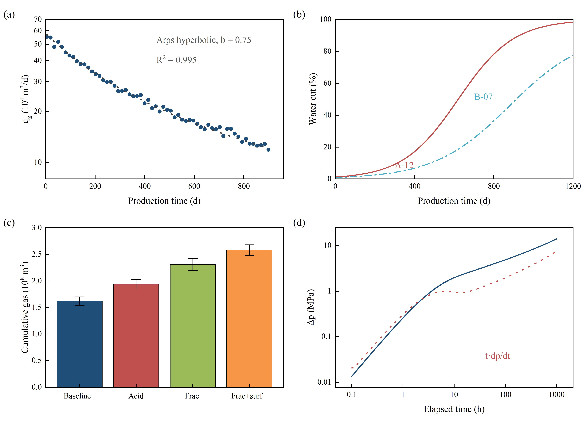
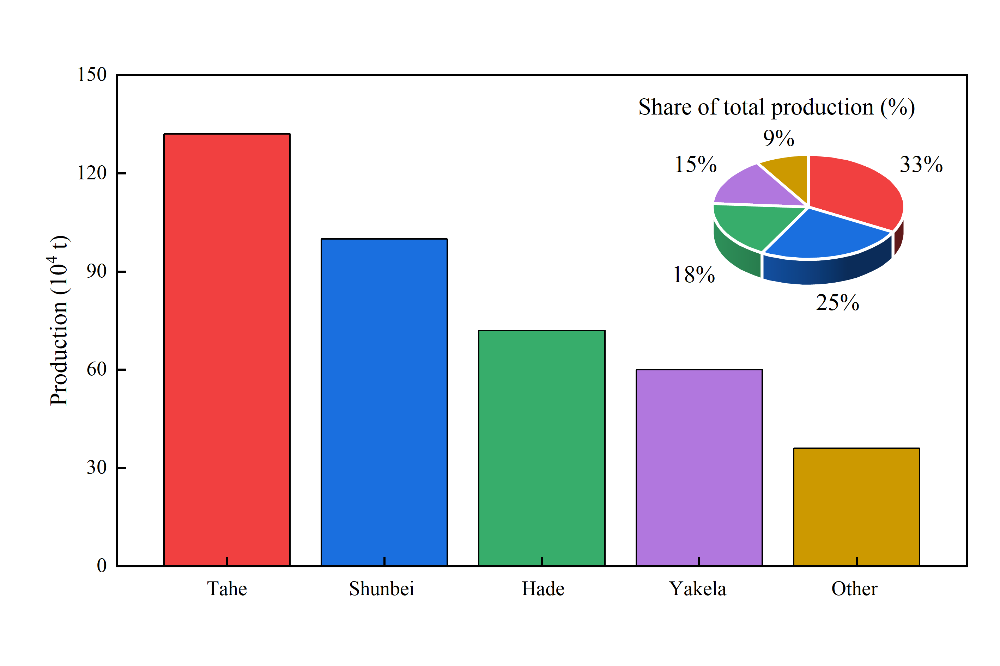
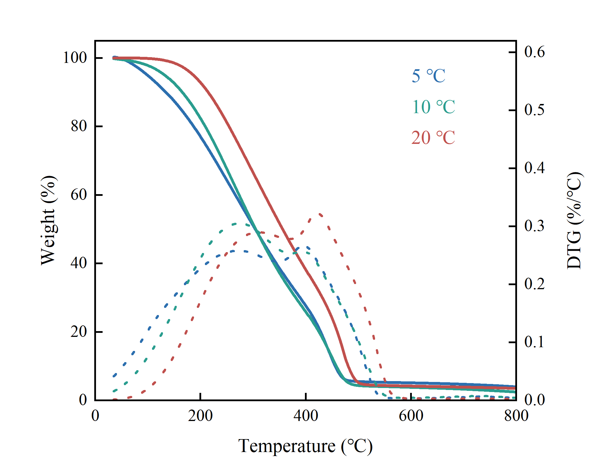

# oil-and-gas-origin-figure

用 Python（originpro）驱动 Origin，产出石油天然气领域 SCI 论文图的技能包：**Python 编排 → Origin 渲染 → 模板打底 → 脚本兜底 → 出图必自检**。

一次出 PNG / TIF(600 dpi) / PDF(矢量) / OPJU，并按固定样式规范自检（尺寸、字体、字号 7–9 pt、出界、文字重叠、细线）。

## 预览

| 2×2 拼图（递减 / 含水 / 措施 / 试井） | 柱状 + 3D 饼（inset 内嵌） |
|---|---|
|  |  |

| TG / DTG 双 Y |
|---|
|  |

## 目录

```
SKILL.md                工作流：明确论点 → 看数据 → 选图 → 预演 → 出图 → 自检 → 交付
ogfig/                  引擎：Page / DualY、style、export、check、cli、templates、data、config
catalog/                图型素材库（INDEX.md 是关键词 → 脚本对照表），预览在 catalog/out/
templates/              预设 .otpu（og_line / og_loglog / og_stack / og_doubley）
references/             style-spec 硬性规范 / chart-selection 选图规则 / pitfalls 38 条实测坑 /
                        origin-2026b-cheatsheet 属性速查 / originpro API 手册
```

## 环境

- Windows + **Origin 2024b 及以上**（2024 早期 10.1.x 有文字上划线、线宽改不动的 bug；2026b / 10.3 实测正常）
- Python 3.10+，`pip install originpro numpy pandas pymupdf`
- 字体：Times New Roman + 宋体（Windows 自带）

## 快速开始

```bash
python -m ogfig.cli doctor                    # 环境自检：Origin 版本、模板、字体
python -m ogfig.cli spec --journal single     # 预演：尺寸 / 字号 / 线宽 / 配色（不开 Origin）
python -m ogfig.cli inspect data.xlsx         # 看数据：列名、范围、单调性、跨量级提示

python catalog/production/decline_dashboard_2x2.py    # 跑一个现成图型
python catalog/production/bar_pie3d.py                # 柱状 + 3D 饼（inset，默认）
python catalog/production/bar_pie3d.py side           # 同一批数据的并排版式
```

脚本都在 skill 根目录跑，产物落在 `catalog/out/<名字>.png / .tif / .pdf / .opju / _gray.png`。

## 作为 agent skill 使用

把整个目录放进你的 skills 目录（例如 `~/.dsh/skills/` 或项目里的 `skills/`），带 `SKILL.md` 即可被识别；
模型按 SKILL.md 的工作流调用 `ogfig` 出图。

## 样式规范（默认值，不必每次重申）

西文 Times New Roman / 中文宋体；字号 7–9 pt（刻度 7、轴标题 8、图例与标注 8、面板字母 9）；
有数据的边主刻度朝内、无次刻度、上边框只留线；双 Y 用 Origin 自带 doubley；题注无边框；
线宽：坐标轴 0.75 pt、曲线 1.0 pt、主刻度长 3。全部可在 `ogfig/config.py` 的 `PREFS` 里改。

## 版式用语（说错就画错）

| 想要 | 说这些词 | 实现 |
|---|---|---|
| 小图套在大图里 | **内嵌小图 / inset / 画中画** | 一个坐标区 + 第二层压在空白处 |
| 两块并排或上下 | 并排双面板、分面 facet、subplot | `Page(1, 2)` / `Page(2, 2)` |
| 同一 X 两套单位 | 双 Y 轴 | `DualY`（`og_doubley` 模板） |

"组合图 + 一个画布"默认按 **inset** 理解（一张图、一个坐标区），不是并排。

## 许可

未声明许可证。如需开源复用，建议补一个（例如 MIT）。
